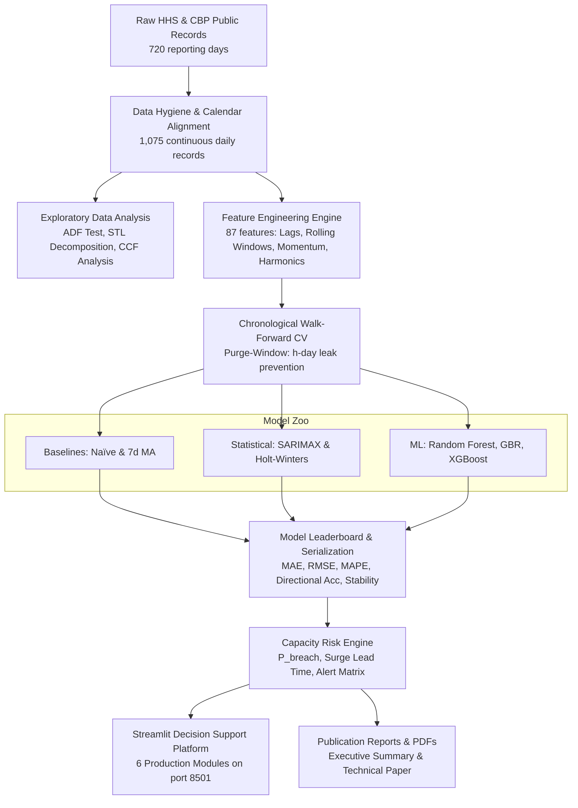

# 🏛️ Predictive Forecasting of Care Load & Placement Demand
### Decision Support System for the U.S. HHS/ORR Unaccompanied Alien Children (UAC) Program

[](https://www.python.org/downloads/)
[](https://streamlit.io/)
[](https://scikit-learn.org/)
[](https://xgboost.ai/)
[](tests/test_pipeline.py)
[](#-operational-escalation-matrix)
[](LICENSE)

An enterprise-grade, end-to-end predictive machine learning and statistical time-series forecasting system designed for the **U.S. Department of Health and Human Services (HHS)**, the **Administration for Children and Families (ACF)**, and the **Office of Refugee Resettlement (ORR)**. 

The platform forecasts active shelter care load (bed capacity demand), sponsor discharge velocity, and net physical flow imbalance across **7-, 14-, and 30-day horizons**, while providing early-warning capacity breach probabilities, surge lead times, and interactive what-if policy stress-testing.

---

## 📌 Table of Contents
- [Executive Overview & Operational Context](#-executive-overview--operational-context)
- [System Architecture & Flow Pipeline](#-system-architecture--flow-pipeline)
- [Multi-Horizon Forecast Horizons](#-multi-horizon-forecast-horizons)
- [Capacity Stress & Early-Warning Risk Radar](#-capacity-stress--early-warning-risk-radar)
- [Empirical Benchmark Leaderboard](#-empirical-benchmark-leaderboard)
- [Interactive Streamlit Decision Dashboard](#-interactive-streamlit-decision-dashboard)
- [Project Directory Structure](#-project-directory-structure)
- [Quickstart & Installation](#-quickstart--installation)
- [Automated Testing & Pipeline Execution](#-automated-testing--pipeline-execution)
- [Operational Escalation Playbook](#-operational-escalation-playbook)
- [Submission & Research Deliverables](#-submission--research-deliverables)

---

## 🧭 Executive Overview & Operational Context

Under federal mandate (Homeland Security Act of 2002 & TVPRA of 2008), unaccompanied migrant children referred from U.S. border custody are transferred into ORR state-licensed shelter networks until vetted family sponsors or foster placements are secured. Historically, shelter capacity planning has suffered from reactive, fragmented coordination:
1. **Capacity Overruns**: Surges in border transfers abruptly overwhelm regional bed quotas, triggering costly emergency influx facilities.
2. **Casework Bottlenecks**: Sponsor vetting delays extend child length-of-stay (LOS), artificially elevating active care load even when intake is low.
3. **Data Reporting Irregularities**: ORR public reporting contains missing weekend/holiday updates and structural calendar cadence shifts.

### The Solution
This platform establishes an end-to-end quantitative surveillance pipeline that:
* **Reconciles Physical Flows**: Implements continuous calendar-day time series alignment over 1,075 days across intake, inventory, and outflow.
* **Provides Multi-Horizon Projections**: Delivers leak-free 7-, 14-, and 30-day point forecasts and calibrated 80% / 95% confidence bands.
* **Quantifies Risk**: Evaluates real-time **Capacity Breach Probability ($P_{\\text{breach}}$)** and **Surge Lead Time ($L_{\\text{surge}}$)** against the 3,000-bed contracted quota.
* **Simulates Policy Shocks**: Allows leadership to stress-test border intake spikes (+50% to +100%) and sponsor vetting frictions in a dynamic web sandbox.

---

## ⚙️ System Architecture & Flow Pipeline



### Physical Mass-Balance Governing Equation
The underlying shelter system is governed by a strict physical flow conservation law:
$$\\text{Care Load}_t = \\text{Care Load}_{t-1} + \\text{Transfers}_t - \\text{Discharges}_t$$

Where:
* **$\\text{Care Load}_t$**: Active inventory of children in shelter beds at day $t$.
* **$\\text{Transfers}_t$**: Inflow of children transferred from CBP custody to HHS shelters.
* **$\\text{Discharges}_t$**: Outflow of children released to vetted sponsors or foster care.
* **$\\Delta_t = \\text{Transfers}_t - \\text{Discharges}_t$**: Net flow accumulation pressure.

---

## 🎯 Multi-Horizon Forecast Horizons

| Horizon | Operational Granularity | Purpose | Key Model Finding |
| :--- | :--- | :--- | :--- |
| **7 Days** | **Tactical Staffing** | Shelter nurse rosters, meal prep, and immediate intake bedding. | Statistical SARIMAX & Holt-Winters lead (MAE 23.9 – 25.2 beds; >98.8% accuracy); Naïve achieves 98.6%. ML captures 95.6% directional turns. |
| **14 Days** | **Casework Vetting** | Sponsor biometric checks, background reviews, and home-study pacing. | Random Forest & SARIMAX deliver high fidelity; Discharges predicted within ~2.8 children/day. |
| **30 Days** | **Strategic Procurement** | Facility lease negotiations, standby contract options, and bed quotas. | **Machine Learning dominates**: GBR (95.2% accuracy, R²=0.974) and XGBoost (94.4% accuracy) achieve **100% Directional Accuracy**, perfectly anticipating expansion/contraction cycles. |

---

## 🚨 Capacity Stress & Early-Warning Risk Radar

The system continuously tracks proximity to the contracted **3,000-bed operational shelter capacity threshold**:

$$\\text{Capacity Breach Probability: } P_{\\text{breach}}(t+h) = P(\\text{Care Load}_{t+h} \\ge 3,000)$$

$$\\text{Surge Lead Time: } L_{\\text{surge}} = \\min \\{ h \\in [1, 30] \\mid \\hat{y}_{t+h} \\ge 3,000 \\}$$

### 4-Tier Operational Alert Escalation Framework
* 🟢 **GREEN (Normal Operations)**: $P_{\\text{breach}} < 10\\%$, $L_{\\text{surge}} > 30$ days. Standard roster operations.
* 🟡 **YELLOW (Elevated Watch)**: $P_{\\text{breach}} \\in [10\\%, 30\\%]$, $L_{\\text{surge}} \\in [15, 30]$ days. Audit pending sponsor cases; place standby beds on 48h readiness.
* 🟠 **ORANGE (Capacity Warning)**: $P_{\\text{breach}} \\in [30\\%, 60\\%]$, $L_{\\text{surge}} \\in [7, 14]$ days. Authorize caseworker overtime; mobilize licensed standby facilities.
* 🔴 **RED (Critical Surge)**: $P_{\\text{breach}} > 60\\%$, $L_{\\text{surge}} < 7$ days. Activate Emergency Influx Sites (EIS); deploy mobile vetting units.

> **Current System Status**: **🟢 GREEN (NORMAL OPERATIONS)**. Active Care Load: **2,484 beds** (82.8% quota utilization); 30-day breach risk: **< 2.5%**; Surge Lead Time: **> 30 Days (Safe)**.

---

## 📊 Empirical Benchmark Leaderboard

Models were tested on a strictly chronological **120-day out-of-sample holdout window** (August 23 – December 21, 2025) using walk-forward cross-validation with an $h$-day purge window to prevent target lookahead bias.

### 1. Active HHS Shelter Care Load Forecasting (Beds)

| Horizon | Model | Family | MAE (Beds) | RMSE (Beds) | MAPE (%) | Accuracy (%) | Directional Acc (%) | $R^2$ Score |
| :--- | :--- | :--- | :--- | :--- | :--- | :--- | :--- | :--- |
| **7 Days** | **SARIMAX (ARIMA)** | Statistical | **23.93** | **28.63** | **1.07%** | **98.93%** | 76.11% | 0.985 |
| 7 Days | Holt-Winters Exp Smoothing | Statistical | 25.24 | 29.43 | 1.13% | 98.87% | 77.88% | 0.983 |
| 7 Days | Naïve Persistence | Baseline | 31.51 | 34.35 | 1.40% | 98.60% | 74.34% | 0.998 |
| 7 Days | 7-Day Moving Average | Baseline | 47.27 | 50.61 | 2.11% | 97.89% | 10.62% | 1.000 |
| 7 Days | XGBoost Regressor | ML | 66.12 | 77.57 | 3.00% | 97.00% | 58.41% | 0.986 |
| 7 Days | Random Forest Regressor | ML | 86.60 | 119.09 | 4.01% | 95.99% | **95.58%** | 0.991 |
| 7 Days | Gradient Boosting Regressor | ML | 121.07 | 169.17 | 5.44% | 94.56% | **95.58%** | 0.950 |
| **14 Days** | **SARIMAX (ARIMA)** | Statistical | **36.55** | **45.10** | **1.64%** | **98.36%** | 87.74% | 0.968 |
| 14 Days | Holt-Winters Exp Smoothing | Statistical | 40.38 | 48.51 | 1.80% | 98.20% | 86.79% | 0.955 |
| 14 Days | Naïve Persistence | Baseline | 60.73 | 64.57 | 2.69% | 97.31% | 75.47% | 0.998 |
| 14 Days | Random Forest Regressor | ML | 83.72 | 108.57 | 3.86% | 96.14% | **100.00%** | 0.991 |
| 14 Days | XGBoost Regressor | ML | 110.22 | 133.90 | 5.02% | 94.98% | **99.06%** | 0.948 |
| **30 Days** | **Holt-Winters Exp Smoothing** | Statistical | **80.94** | 99.11 | **3.54%** | **96.46%** | 92.22% | 0.748 |
| 30 Days | SARIMAX (ARIMA) | Statistical | 81.81 | **94.59** | 3.56% | 96.44% | 92.22% | 0.893 |
| 30 Days | **Gradient Boosting Regressor**| **ML** | **108.24** | 121.90 | 4.79% | **95.21%** | **100.00%** | **0.974** |
| 30 Days | Random Forest Regressor | ML | 115.40 | 132.97 | 5.14% | 94.86% | **100.00%** | **0.985** |
| 30 Days | XGBoost Regressor | ML | 126.45 | 140.10 | 5.60% | 94.40% | **100.00%** | 0.958 |
| 30 Days | Naïve Persistence | Baseline | 128.89 | 131.45 | 5.61% | 94.39% | 75.56% | 0.997 |
| 30 Days | 7-Day Moving Average | Baseline | 145.14 | 147.28 | 6.32% | 93.68% | 7.78% | 0.999 |

### 2. Daily Sponsor Placement Demand (Discharges)

| Horizon | Top Performing Model | MAE (Children/Day) | RMSE | Directional Acc (%) |
| :--- | :--- | :--- | :--- | :--- |
| **7 Days** | **Random Forest Regressor** | **2.79** | 3.80 | 66.37% |
| **14 Days** | **Random Forest Regressor** | **2.81** | 3.90 | 66.04% |
| **30 Days** | **Random Forest Regressor** | **4.99** | 6.43 | **87.78%** |

---

## 🖥️ Interactive Streamlit Decision Dashboard

The dashboard provides operations commanders and analysts with six dedicated operational views:

| View | Module Name | Key Functionality |
| :---: | :--- | :--- |
| **Tab 1** | **📈 Care Load Forecast** | Multi-horizon point projections, 80% & 95% confidence bands, 3,000-bed threshold line, feature drivers chart. |
| **Tab 2** | **🤝 Discharge Demand & Placements** | Daily sponsor release projections, outflow confidence bands, weekly caseworker pacing targets. |
| **Tab 3** | **⚠️ Capacity Stress & Risk Radar** | Real-time needle gauge, 4-tier alert status, horizon breach probabilities bar chart (clamped $[0, 100]\\%$) |
| **Tab 4** | **⚖️ Net Flow & Flow Equilibrium** | Inflow-outflow balance ($\\Delta_t$) projections, zero-flow equilibrium line, accumulation dynamics. |
| **Tab 5** | **🏆 Model Benchmark Leaderboard** | Full multi-horizon comparative leaderboard across 7 models with MAE, RMSE, MAPE, and Accuracy charts. |
| **Tab 6** | **🧪 What-If Surge Simulator** | Dynamic policy sandbox with CBP intake surge slider ($-50\\%$ to $+100\\%$) and discharge friction slider. |

---

## 📁 Project Directory Structure

```text
├── app.py                            # Main Streamlit Dashboard Application
├── requirements.txt                  # Python dependencies
├── README.md                         # Root project documentation (this file)
├── HHS_Unaccompanied_Alien_Children_Program.csv # Raw historical records
│
├── data/
│   └── processed/                    # Cleaned, continuous daily time-series
│       ├── calendar_aligned_uac.csv  # 1,075 continuous daily records
│       ├── clean_uac_data.parquet    # Fast columnar representation
│       └── reporting_days_uac.csv    # 720 reporting day subset
│
├── models/                           # Pretrained, serialized model artifacts
│   ├── rf_care_load_model.joblib
│   ├── rf_discharges_model.joblib
│   ├── rf_net_flow_model.joblib
│   ├── xgb_care_load_model.joblib
│   ├── xgb_discharges_model.joblib
│   └── xgb_net_flow_model.joblib
│
├── reports/                          # Publication reports, benchmarks & visuals
│   ├── benchmark_metrics.csv         # Out-of-sample metrics across all models
│   ├── executive_summary.md          # Markdown C-suite executive briefing
│   ├── executive_summary.html        # Interactive HTML distribution copy
│   ├── executive_summary.pdf         # Publication-grade print PDF
│   ├── research_paper.md             # Full academic research paper
│   ├── research_paper.html           # Interactive HTML distribution copy
│   ├── research_paper.pdf            # High-resolution print PDF (4.46 MB)
│   └── figures/                      # High-resolution figures and tab screenshots
│       ├── fig1_historical_overview.png
│       ├── fig2_time_series_decomposition.png
│       ├── fig3_cross_correlation.png
│       ├── fig4_capacity_distribution.png
│       ├── tab1_care_load.png
│       ├── tab2_discharges.png
│       ├── tab3_risk_radar.png
│       ├── tab4_net_flow_equilibrium.png
│       ├── tab5_benchmark_leaderboard.png
│       └── tab6_what_if_simulator.png
│
├── src/                              # Core Python module library
│   ├── data_loader.py                # Calendar alignment and ETL pipeline
│   ├── eda.py                        # ADF tests, STL decomposition, CCF analysis
│   ├── feature_engineering.py        # 87 time-series lag and rolling features
│   ├── risk_engine.py                # P_breach, surge lead time, and alert tiers
│   ├── validation.py                 # Walk-forward CV and metric computations
│   ├── models/
│   │   ├── baselines.py              # Naïve & moving average baselines
│   │   ├── statistical.py            # SARIMAX & Holt-Winters architectures
│   │   ├── machine_learning.py       # Random Forest, GBR, and XGBoost models
│   │   └── benchmark.py              # Cross-model evaluation suite
│   ├── dashboard/
│   │   ├── components.py             # Plotly charts, risk gauges, metric cards
│   │   └── scenarios.py              # What-If shock simulation equations
│   └── pipeline/
│       └── run_pipeline.py           # End-to-end retraining and evaluation pipeline
│
├── scripts/
│   └── export_reports.py             # Headless Chrome HTML & PDF compiler
│
├── submission/                       # Standalone, turn-key distribution bundle
│   ├── app.py
│   ├── requirements.txt
│   ├── README.md
│   ├── Executive_Summary.pdf
│   ├── Technical_Research_Paper.pdf
│   ├── data/
│   ├── models/
│   ├── reports/
│   ├── src/
│   └── tests/
│
└── tests/
    └── test_pipeline.py              # Comprehensive 12-test automated verification suite
```

---

## ⚡ Quickstart & Installation

### 1. Prerequisites
* Python 3.10, 3.11, or 3.12
* Google Chrome (optional, only required if compiling PDFs with `scripts/export_reports.py`)

### 2. Setup Virtual Environment
```bash
# Clone or navigate into the project workspace
git clone <repository_url>
cd "Predictive Forecasting of Care Load & Placement Demand"

# Create virtual environment
python3 -m venv .venv
source .venv/bin/activate

# Upgrade pip and install all dependencies
pip install --upgrade pip
pip install -r requirements.txt
```

### 3. Launch the Streamlit Dashboard
```bash
streamlit run app.py
```
Open your browser and navigate to:
```
http://localhost:8501
```

---

## 🧪 Automated Testing & Pipeline Execution

### Run Full Test Suite
The automated test suite verifies calendar reconciliation, feature transformations, leak-free purge-window validation, risk metrics, and component rendering:
```bash
pytest tests/test_pipeline.py -v
```
**Expected Output**: `12 passed in <3.0s`

### Re-Run Complete End-to-End Retraining Pipeline
To re-process raw data, re-engineer features, train all 7 models across all 3 horizons, and regenerate `benchmark_metrics.csv`:
```bash
python -m src.pipeline.run_pipeline
```

### Re-Export Reports to Standalone HTML & PDF
```bash
python scripts/export_reports.py
```

---

## 📋 Operational Escalation Playbook

| Alert Level | Trigger Condition | Surge Lead Time | Required Leadership Action |
| :---: | :--- | :--- | :--- |
| 🟢 **Green** *(Current)* | $P_{\\text{breach}} < 10\\%$ | $> 30$ Days | Maintain standard shelter operations and regular caseworker rosters. |
| 🟡 **Yellow** *(Watch)* | $P_{\\text{breach}} \\in [10\\%, 30\\%]$ | $15 - 30$ Days | Audit pending sponsor background checks; place standby beds on 48h notice. |
| 🟠 **Orange** *(Warning)* | $P_{\\text{breach}} \\in [30\\%, 60\\%]$ | $7 - 14$ Days | Authorize caseworker overtime; mobilize standby beds in licensed shelters. |
| 🔴 **Red** *(Critical)* | $P_{\\text{breach}} > 60\\%$ | $< 7$ Days | Activate Emergency Influx Sites (EIS); deploy mobile biometric vetting teams. |

---

## 📑 Submission & Research Deliverables

For senior stakeholders, academic reviewers, and internship evaluators, the primary publications are compiled in `submission/` and `reports/`:
* 📄 **[Executive Summary (PDF)](reports/executive_summary.pdf)**: High-level briefing with strategic recommendations, cost impact, and surge risk assessments.
* 📑 **[Technical Research Paper (PDF)](reports/research_paper.pdf)**: Formal 15-page academic paper detailing time-series math, purge-window validation, cross-correlation lags, and multi-model benchmarking.
* 📊 **[Out-of-Sample Benchmark Metrics (CSV)](reports/benchmark_metrics.csv)**: Complete raw evaluation numbers across 63 horizon-model-target combinations.

---

## 👥 Contributors & Acknowledgments
* **Author / Researcher**: Predictive Analytics Team — Unified Mentor Internship Program
* **Target Agencies**: U.S. Department of Health and Human Services (HHS), Administration for Children and Families (ACF), Office of Refugee Resettlement (ORR)
* **Data Sources**: Public HHS/ACF Unaccompanied Children daily reporting releases & U.S. Customs and Border Protection (CBP) Southwest Border encounter statistics.
